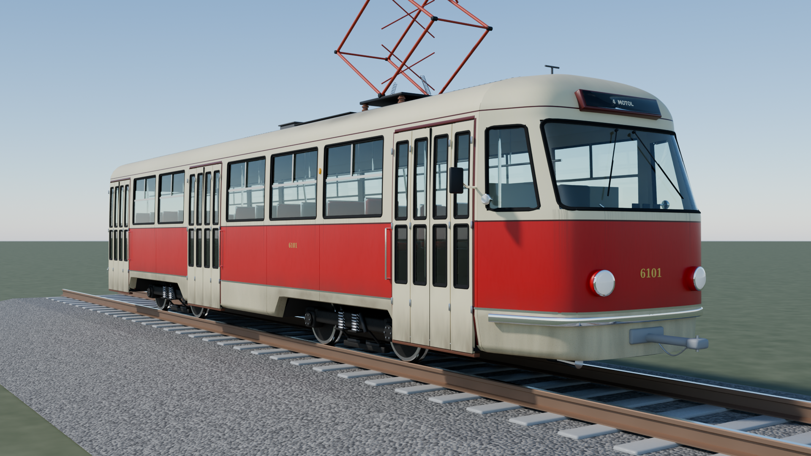

# Tatra T3 6101 · interaktivní 3D model

> **Neoficiální fanouškovský projekt.** Model, kód i texty vznikly s pomocí AI (Claude) z typového výkresu, barevných pohledů a fotografií vozů 6102 a 6149. Kde výkres nic neříká, jde o odhad; karty dílů takové údaje označují.
>
> **Unofficial fan project.** The model, code and texts were made with AI (Claude) from the type drawing, coloured elevations and photos of cars 6102 and 6149. Where the drawing says nothing, values are estimates, and the part cards mark them.



Interaktivní 3D model první pražské tramvaje Tatra T3, prototypu 6101 z roku 1960, postavený v rozměrech druhého prototypu 6102. Otáčení, přiblížení, rozložení na díly, otevírání dveří, pohled do interiéru a karta ke každému dílu s popisem a technickými údaji. Česky a anglicky.

## Spuštění / Running it

- **Online:** po zapnutí GitHub Pages na `https://root-code-11.github.io/t3-3d-manual/`
- **Lokálně / locally:** stránka načítá model ze souboru, proto ji otevřete přes lokální server, ne dvojklikem:

```
python3 -m http.server 8000
```

a pak / then open http://localhost:8000

## Co je kde / What is where

| Cesta | Obsah |
|---|---|
| `index.html` | stránka s 3D prohlížečem, kartami dílů a přepínačem CZ/EN |
| `t3_6101.txt` | model pro stránku (GLB s 2K texturami, zakódovaný base64) |
| `model/t3_6101.glb` | plný model se 4K texturami pro Blender, three.js a další nástroje |
| `model/t3_6101_web.glb` | lehčí model pro web (stejný obsah jako `t3_6101.txt`) |
| `blender/build_t3.py` | celý model postavený kódem v Blenderu |
| `blender/t3_textures.py` | malování PBR textur (nátěr, spáry, lehké opotřebení) |
| `blender/fonts/` | písma DejaVu pro čísla vozu a orientaci |
| `docs/` | rendery: 3/4 pohled, oba boky, čelo |

## Úpravy modelu / Rebuilding the model

Testováno s Blenderem 5.2 jako Python modulem (`pip install bpy`):

```
python3 blender/build_t3.py -- out --glb --web       # model .glb (4K) a lehčí verze pro web
python3 blender/build_t3.py -- out --render          # render 1920 × 1080 na trati
base64 -w0 out/t3_6101_web.glb > t3_6101.txt         # model pro stránku
```

Souřadnice: x dopředu, y nahoru, z doprava, metry, počátek na temeni kolejnice pod středem vozu. Každý díl je prázdný objekt s id dílu a směrem rozložení; křídla dveří mají počátek v pantu, dvojkolí v nápravě.

Coordinates: x forward, y up, z to the right, metres, origin on the rail top under the vehicle centre. Every part is an empty carrying its id and explode direction; door leaves have their origin on the hinge, wheelsets on the axle.

## Prameny / Sources

- Wikipedia: Tatra T3 (Maruna 1974; Linert, Fojtík 2005)
- prazsketramvaje.cz, tram-bus.cz, abczech.cz
- Wikimedia Commons: Trams in Prague by registration number
- Typový výkres T3 a barevné pohledy / T3 type drawing and coloured elevations
- Fotografie vozů 6102 a 6149 / photos of cars 6102 and 6149

Inspirace / inspired by: [BMW R 12 · interaktivní 3D manuál](https://github.com/lukasersil/bmw-r12-3d-manual) (Lukáš Eršil)
